# PowerMonitor™ 5000 Power Quality & Energy Monitoring Advanced Multi-Device Dashboard

**Object Name**: `raC_4_01_raC_Dvc_PM5000_PQEMDashboard_UI`

---

# Section 1: Overview

The PowerMonitor™ 5000 Power Quality & Energy Monitoring Advanced Multi-Device Dashboard provides a centralized, organization-level interface for monitoring multiple PM5000 devices across factories, facilities, and production areas. This dashboard object complements the existing standalone faceplates (`raC_Dvc_PM5000_PQEM`) by offering aggregated views and multi-device analytics.

## Key Features

| Feature | Description |
|---------|-------------|
| **Organizational Hierarchy Navigation** | Browse devices using a hierarchical tree structure (Factory → Facility → Device) |
| **Dynamic Dashboard Scoping** | View data at device-level, facility-level, or factory-level with automatic aggregation |
| **Unified Data Visualization** | Single interface for monitoring multiple PM5000 units simultaneously |
| **Comprehensive Analytics** | Aggregated metrics across energy consumption, power quality events, alarms, and trends |
| **Flexible Deployment** | Use alongside standalone faceplates—choose multi-device dashboards for aggregate views or standalone faceplates for individual device deep-dives |

## Available Dashboards

The multi-device dashboard includes the following tabs for comprehensive power monitoring:

| Dashboard | Purpose |
|-----------|---------|
| **Common Dashboard** | Overview metrics and device status across selected organization nodes |
| **Energy Dashboard** | Real-time and historical energy consumption (kW, kWh, demand) |
| **PQ Events Dashboard** | Power quality event logs with filtering and classification |
| **ITI and SEMI F47 Chart Dashboard** | IEEE 1159 compliance curves for voltage sag/swell analysis |
| **Alarm Log Dashboard** | Aggregated alarm and event tracking across devices |
| **Calendar Trends** | Time-based energy usage patterns and historical comparisons |
| **Trend Viewer** | Multi-parameter, multi-device historical trend analysis |
| **Reports** | Configurable report generation and scheduling |
| **Help** | Dashboard documentation and reference information |

## Supported Devices

| Catalog Number | Description |
|----------------|-------------|
| **1423-M5E** | PowerMonitor 5000 |
| **1423-M6E** | PowerMonitor 5000 |
| **1423-M8E** | PowerMonitor 5000 |

> **Note**: Available data and dashboard features may vary based on the capabilities of each device model.

## When to Use This Object

| Use Case | Recommended Object |
|----------|-------------------|
| Monitor multiple PM5000 devices with aggregated views across organizational hierarchy (factories, facilities, production lines) | **Multi-Device Dashboard** (this object) |
| Individual device-level detailed diagnostics and configuration for a single PM5000 unit | **Standalone Faceplates** (`raC_Dvc_PM5000_PQEM` v4.00) |

Both objects can coexist in the same FactoryTalk Optix project to provide comprehensive monitoring at both organizational and device levels.

---

# Section 2: Functional Description

The PowerMonitor™ 5000 Advanced Multi-Device Dashboard provides a centralized interface for monitoring multiple PM5000 devices through a flexible organizational tree structure. Users navigate the tree to select facilities, departments, or individual devices, and the dashboard automatically displays aggregated metrics for the selected scope.

## Organizational Hierarchy Navigation

The dashboard organizes PM5000 devices in a flexible hierarchical tree that you can configure based on your organizational structure:

| Feature | Description |
|---------|-------------|
| **Multi-Level Support** | Define as many organizational levels as needed (e.g., Factory → Region → Plant → Building → Device) |
| **User Selection** | Click any node in the tree to scope the dashboard to that level |
| **Automatic Aggregation** | Dashboard tabs display aggregated metrics for all devices under the selected node |

## Dynamic Dashboard Updates

When you select an organizational node:

- Dashboard tabs update instantly to show data for that scope
- Device-level selection shows individual PM5000 data
- Facility/Group selection shows combined metrics across all child devices
- All views include real-time and historical data

## Data Collection & Storage

| Capability | Description |
|------------|-------------|
| **Real-Time Monitoring** | Live power metrics from all configured PM5000 devices |
| **Comprehensive Data Logging** | All device data is automatically stored in an embedded database, including energy consumption, power quality events, alarms, waveforms, and device logs |
| **Historical Data Access** | Retrieve and analyze historical data from any time period across all monitored devices for trend analysis and compliance reporting |
| **Embedded Database** | Data is stored locally in the FactoryTalk Optix project (no external database required) |
| **Network Connectivity** | PM5000 devices must be on the same network as the FactoryTalk Optix runtime |
| **E-mail Alerts** | Configure notifications for power quality events across all monitored devices |

---

# Section 3: Required Files

The PowerMonitor™ 5000 Advanced Multi-Device Dashboard Object includes a model, HMI dashboard screens, and graphic symbols. The revision number (e.g., 4.01) used in filenames can change as new revisions are created. **No controller files are required.**

## FactoryTalk Optix Library Files

FactoryTalk Optix applications require importing the desired library objects located in the **PowerDevice_v4R** library folder.

| Object Name | Type | Description |
|-------------|------|-------------|
| `raC_4_01_raC_Dvc_PM5000_PQEMDashboard_Model` | Model | Data model containing device organization, configuration variables, and database stores |
| `raC_4_01_raC_Dvc_PM5000_PQEMDashboard_UI` | UI | Dashboard screens and user interface components |

---

# Section 4: Configuring the Library Object

## 4.1 Importing Library Objects

See *Using FactoryTalk Optix* and *Using Style Sheets* for general details on using this library with FactoryTalk Optix and applying the ISA Style Sheet prior to configuring the PM5000 Multi-Device Dashboard object.

> **Prerequisite**: The Multi-Device Dashboard object requires the standalone **PowerMonitor™ 5000 Power Quality and Energy Monitoring Advanced Faceplates** (`raC_Dvc_PM5000_PQEM`) to be already imported in your project. To see how to import the standalone faceplates, refer to **PowerMonitor™ 5000 Power Quality and Energy Monitoring Advanced Faceplates (raC_Dvc_PM5000_PQEM) > Configuring the Library Object** chapter.
>
> The following steps assume that you have already imported `raC_4_00_raC_Dvc_PM5000_PQEM_UI` and `raC_4_00_raC_Dvc_PM5000_PQEM_Model` into your project.

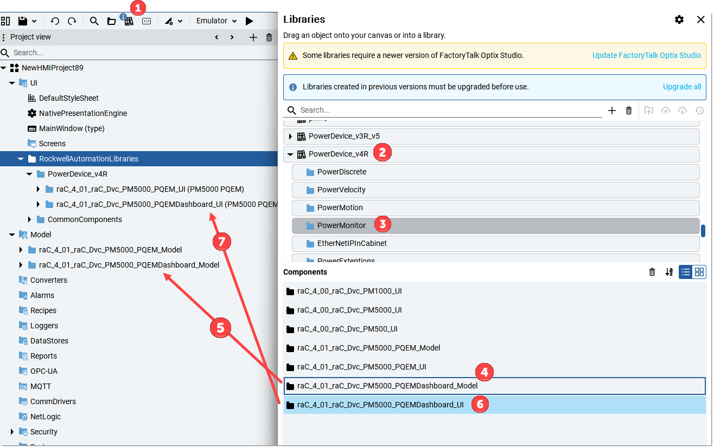

From the **PowerDevice_v4R** library, perform the following steps:

**Step 1: Import the Model Object**
- Drag-and-drop the `raC_4_01_raC_Dvc_PM5000_PQEMDashboard_Model` object into the **Model** folder in your project

**Step 2: Import the UI Object**
- Drag-and-drop the `raC_4_01_raC_Dvc_PM5000_PQEMDashboard_UI` object into the **UI** folder in your project

**Recommended folder organization:**
- Create a folder named `RockwellAutomationLibraries`
- Within that folder, create a `PowerDevice_v4R` sub-folder to organize each library
- Choose "Skip All" for any existing component conflicts

**Step 3: Verify Import Completion**
- Both objects should now appear in your project's Model and UI folders
- You are ready to proceed with configuration

---

## 4.2 Updating Project References

This library solution leverages multiple NuGet packages for enhanced functionality. After importing the library objects, you will receive NetLogic errors stating that the solution has failed to build. To resolve these errors, follow the steps below.

**Prerequisites:**
- Internet connection required for the first build (to download NuGet packages)
- Subsequent builds work offline using cached packages

**Steps:**

1. **Navigate to the project file folder**
   - Click the folder button in the toolbar, then click the folder button again to open the path in Windows Explorer

2. **Open the .csproj file**
   - In the `NetSolution` folder, find the file with the extension `.csproj` (filename matches your project name)
   - Open it in a simple text editor like Notepad
  
  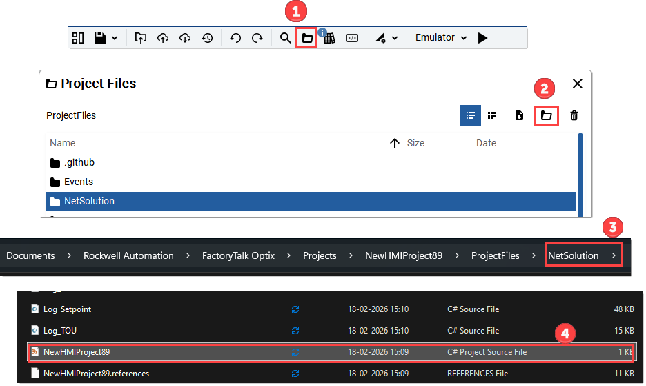

3. **Add NuGet package references**
   - Paste the following code directly before the final line (`</Project>`):

```xml
<ItemGroup>
  <PackageReference Include="Newtonsoft.Json" Version="13.0.3" />
  <PackageReference Include="FluentFTP" Version="49.0.2" />
  <PackageReference Include="QuestPDF" Version="2024.3.0" />
  <PackageReference Include="Meta.Numerics" Version="4.1.4" />
</ItemGroup>
```
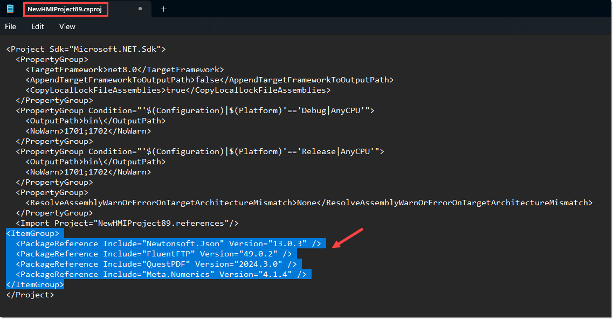

4. **Save the file**
   - Save and close the text editor

5. **Build the project**
   - Return to Optix Studio and build the project
   - The build process will automatically download all NuGet packages and resolve dependencies
   - The project should now build successfully without NetLogic errors

> **Note**: All dependencies are automatically managed through NuGet. No manual DLL files need to be placed in the project folder.

---

## 4.3 Set-Up Initial Configuration Script

A provided script must be run to configure required links between models and databases.

> **Note**: The following steps assume that you have already imported `raC_4_01_raC_Dvc_PM5000_PQEM_Model` and `raC_4_01_raC_Dvc_PM5000_PQEM_Setup` into your project as part of the standalone faceplates import (see Section 4.1 Prerequisite).

1. Navigate to the **Model** node
2. Locate and expand `raC_4_01_raC_Dvc_PM5000_PQEM_Model`
3. Right-click on `raC_4_01_raC_Dvc_PM5000_PQEM_Setup`
4. Select **"Execute SetupInitialConfiguration"** to automatically configure all required objects

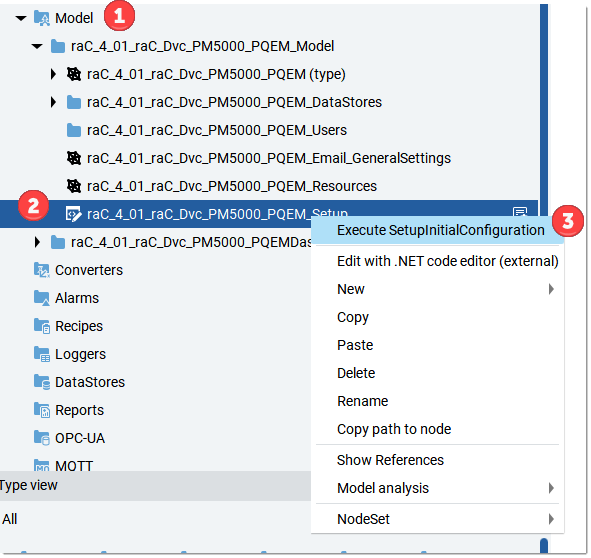

---

## 4.4 Configuring Global Parameters

To configure the global parameters for the dashboard:

**Step 1: Navigate to Configuration Settings**
- Select **Model > raC_4_01_raC_Dvc_PM5000_PQEMDashboard_Model > Properties**

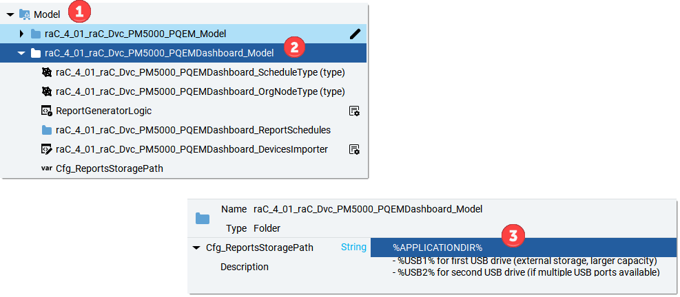

**Step 2: Configure Report Storage Path (`Cfg_ReportsStoragePath`)**

Specify where PDF reports will be stored. Choose from the following options:

| Storage Option | Description |
|----------------|-------------|
| `%APPLICATIONDIR%` | Panel internal memory (limited capacity, ~2-5GB depending on model) |
| `%USB1%` | First USB drive (external storage, larger capacity) |
| `%USB2%` | Second USB drive (if multiple USB ports available) |
| `\\192.168.1.1\Reports\` | Network Shared Path (store reports on a shared folder accessible over the network) |

> **Note**: Network path storage is currently supported on Desktop only; not available on Optix Panel.

**Fallback Behavior**: If the configured storage location is unavailable at startup, the system automatically falls back to `%APPLICATIONDIR%`.

---

## 4.5 Creating PowerMonitor Organization Tree

The device organization tree defines how PM5000 devices are grouped (factory, facility, area, line, etc.). This structure is required so the dashboard can aggregate data and scope views based on the user's selection in the navigation tree.

### 4.5.1 Prepare CSV Template

1. **Locate the Template File**
   - Browse to: `Project Files > res > raC_4_01_raC_Dvc_PM5000_PQEM_Dashboard_Model_Template.csv`
  
  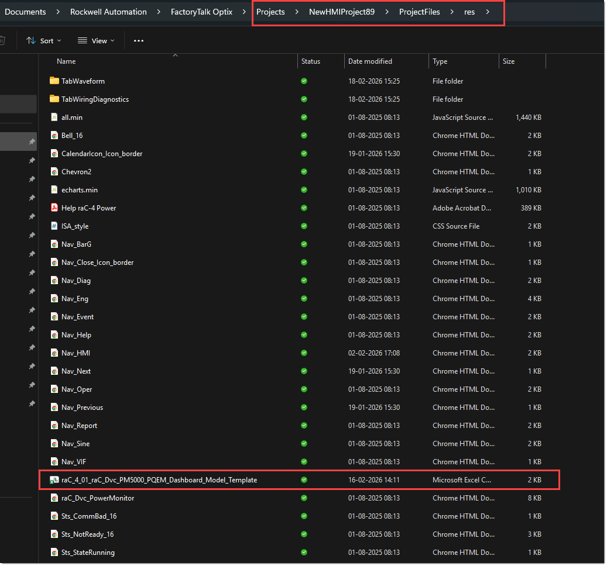

2. **Edit Device Information**
   - Open the file and fill in device information for import
   - Save the updated CSV file

3. **Populate Device Information**
   - Add each PM5000 device with its IP address, device name, and organizational hierarchy
   - Follow the exact column format specified in the template
   - Save and Close the csv file
   
   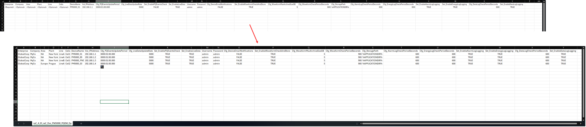

### 4.5.2 Execute Device Importer Script

1. **Run the Device Importer**
   - Navigate to **Model > raC_4_01_raC_Dvc_PM5000_PQEMDashboard_Model > raC_4_01_raC_Dvc_PM5000_PQEMDashboard_DevicesImporter**
   - Right-click and select **"Execute Import"**

   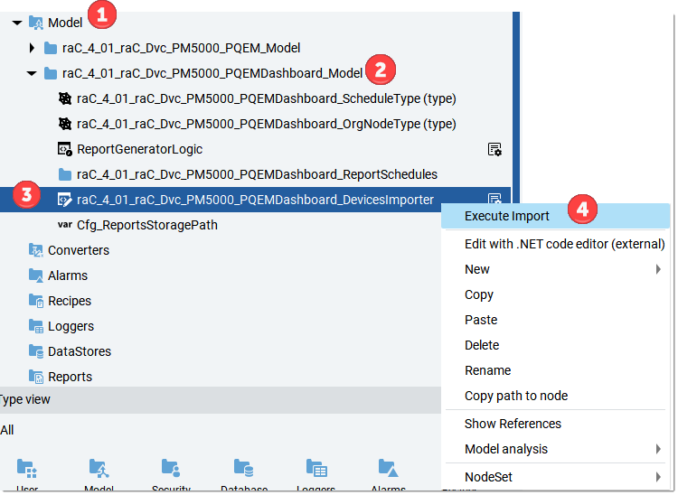

2. **Importer Behavior**
   - Reads the CSV file and automatically creates the organizational tree structure
   - Places each device under its designated organizational node

3. **Verify Organization Tree Creation**
   - After execution completes, go to: `Model > raC_4_01_raC_Dvc_PM5000_PQEMDashboard_Model > PM5000_PQEM_OrgModel`
   - Confirm all devices appear under the correct organizational hierarchy
   - Confirm each device instance is configured correctly and each parameter matches the CSV input

   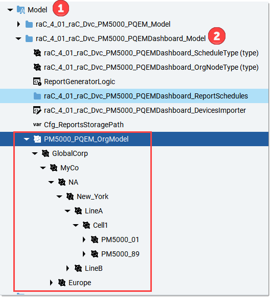

   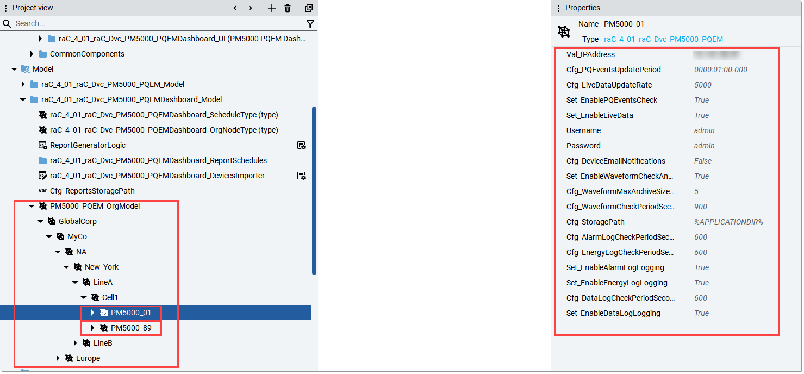

---

## 4.6 Using the Dashboard Screen

The PowerMonitor™ 5000 Advanced Multi-Device Dashboard is a full-screen application that provides comprehensive monitoring across your organizational hierarchy. Unlike the standalone faceplates, this dashboard screen does not include pre-configured graphic symbols. You must integrate it into your project's navigation structure.

**Dashboard Screen Location:**
`raC_4_01_raC_Dvc_PM5000_PQEMDashboard_UI > raC_4_01_raC_Dvc_PM5000_PQEMDashboard`

### Integration Options

Choose one or more of the following methods to make the dashboard accessible to users:

| Option | Method | Description |
|--------|--------|-------------|
| **Option 1** | Navigation Panel Integration | Add the dashboard screen to your main navigation panel (sidebar, menu bar, or tab control). Users navigate to the dashboard from the main menu. |
| **Option 2** | Launch Button | Create a button on an existing HMI screen. Configure the button to open/navigate to the dashboard screen when clicked. |
| **Option 3** | Panel Loader | Use a Panel Loader control to dynamically load the dashboard screen into a designated area. Allows embedding the dashboard within a larger application layout. |

### Recommended Setup

For most deployments, we recommend **Option 1** (Navigation Panel Integration) or **Option 2** (Launch Button) to provide intuitive user access:

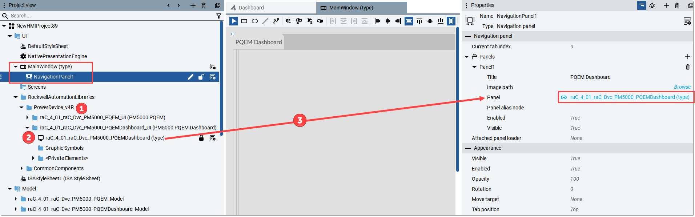

1. Identify where in your HMI structure users should access the dashboard (main menu, toolbar, sidebar)
2. Create a navigation link or button pointing to the `raC_4_01_raC_Dvc_PM5000_PQEMDashboard` screen

---

# Section 5: Initializing the Database

The PowerMonitor™ 5000 Advanced Multi-Device Dashboard automatically collects and stores comprehensive device data in SQLite databases. Data logging is configured per device and runs continuously in the background.

## Data Logging Overview

The system logs the following data categories based on device configuration:

| Data Category | Description |
|---------------|-------------|
| **Power Quality Events** | Sags, swells, transients, interruptions, harmonics |
| **Energy Logs** | kWh, kVARh, kVAh, demand values |
| **Data Logs** | Real-time parameters configured on device |
| **Alarm Logs** | Device alarms with timestamps and severity |
| **Waveforms** | Captured waveform data for PQ events |

## Data Logging Configuration

For each PM5000 device, the following parameters control logging behavior:

| Parameter | Description |
|-----------|-------------|
| `Set_EnablePQEventsCheck` | Enable/disable power quality event logging |
| `Set_EnableEnergyLogLogging` | Enable/disable energy consumption logging |
| `Set_EnableDataLogLogging` | Enable/disable real-time data logging |
| `Set_EnableAlarmLogLogging` | Enable/disable alarm logging |
| `Set_EnableWaveformCheckAndStore` | Enable/disable waveform archival |
| `Cfg_PQEventsUpdatePeriod` | Check interval for new power quality events |
| `Cfg_EnergyLogCheckPeriodSeconds` | Check interval for energy log updates |
| `Cfg_DataLogCheckPeriodSeconds` | Check interval for real-time data updates |
| `Cfg_AlarmLogCheckPeriodSeconds` | Check interval for alarm log updates |
| `Cfg_WaveformCheckPeriodSeconds` | Check interval for new waveforms |

## Energy Log: Fixed Parameters

Energy Log always logs the following predefined parameters, regardless of device configuration:

| Parameter | Description |
|-----------|-------------|
| `kW_Demand` | Active power demand |
| `kVAR_Demand` | Reactive power demand |
| `kVA_Demand` | Apparent power demand |
| `Demand_PF` | Demand power factor |
| `Projected_kW_Demand` | Projected active power demand |
| `Projected_kVAR_Demand` | Projected reactive power demand |
| `Projected_kVA_Demand` | Projected apparent power demand |
| `Total_kWh_Fwd` | Total forward active energy |
| `Total_kWh_Rev` | Total reverse active energy |
| `Total_kWh_Net` | Net active energy (forward - reverse) |
| `Total_kVARh_Fwd` | Total forward reactive energy |
| `Total_kVARh_Rev` | Total reverse reactive energy |
| `Total_kVARh_Net` | Net reactive energy |
| `Total_kVAh` | Total apparent energy |

## Data Logging: Flexible Auto-Detecting Parameters

Data Log is flexible and auto-detecting. The system automatically discovers and logs whatever parameters are configured in the PM5000 device.

**How It Works:**

1. User configures parameters to log on the PM5000 device itself
2. PM5000 logs these parameters in its CSV files
3. Dashboard's DataLogger reads the CSV headers and automatically detects which parameters are present
4. Database dynamically creates columns for all discovered parameters
5. New parameters added to the PM5000 configuration are automatically logged on the next check cycle

> **Tip**: To check the full parameter list and how to configure them, see: **1426-UM001L-EN-P** and refer to the *Data Log* chapter.

If you add new parameters to your PM5000 device configuration, the Dashboard automatically begins logging them without requiring manual database updates or software changes.

---

## Initial Run & Periodic Checks

### Initial Run (First Startup)

During the first startup of the PQEM Dashboard, the system performs a one-time historical data synchronization from each connected PM5000 device. This ensures that the database is initially populated with the device's past measurement history.

**Historical Data Retrieval:**

Upon first run, the system scans the PM5000 storage for all existing CSV log files and imports their contents into the database. To prevent excessive load, the import is limited to the **most recent five years** of recorded data.

The following log managers participate in the initial retrieval:

| Log Manager | Function |
|-------------|----------|
| `db_EnergyLogManager` | Imports historical energy data records |
| `db_DataLogger` | Imports historical data logs |
| `db_WaveformArchiveManager` | Imports stored waveform files |

**Behavior During First Startup:**

1. Each configured device connects to its corresponding PM5000 unit and enumerates all available CSV log files
2. All eligible files (within the five-year retention window) are parsed and logged into the database
3. Background processes manage the import to ensure data consistency and integrity
4. Depending on the volume of historical data stored on the device, the initial synchronization may require several minutes to complete

> **Note**: PQ Events and Alarm logging do not perform an initial run. These begin collecting data only from the moment the system starts.

### Periodic Checks

After initial load completes (where applicable), the system runs periodic checks at configured intervals:

| Log Manager | Function |
|-------------|----------|
| `db_PQLogger` | Periodic check for new power quality events |
| `db_EnergyLogManager` | Periodic check for new energy records |
| `db_DataLogger` | Periodic check for new real-time data; auto-detects new columns |
| `db_AlarmLogManager` | Periodic check for new alarms |
| `db_WaveformArchiveManager` | Periodic check for new waveforms |

Periodic tasks poll each device for new data since the last check. New data is automatically appended to the appropriate database tables. Dashboard updates reflect the latest data within seconds of the check cycle.

---

## Impact of Incomplete Data Logging

If data logging is not configured correctly or becomes disabled, related dashboard screens will not show data.

**Recommendation:**

- Ensure all required logging parameters are enabled for each discovered device (refer to the parameter table in Section 4.5.2)
- If additional measurements or diagnostics are needed, enable them on the PM5000. The Dashboard will auto-log them on the next cycle.

For supported log types and configuration details, see the PM5000 User Manual (**1426-UM001L-EN-P** - November 2022): *Chapter No.6 Logging*

---

# Section 6: Dashboard Screens

The multi-device dashboard provides nine distinct screens for comprehensive power monitoring and analysis. Each screen is scoped to your selected organization node (facility, building, or device level) and displays aggregated data when multiple devices are selected. Below, each screen is documented with a description, numbered visual layout, and detailed content table.

---

## 6.1 Organization Tree

**Short Description**

The Organization Tree is the navigation hub for the entire dashboard. It is built automatically from the org model you created in Section 4.5 and displays your facility hierarchy (Factory → Facility → Device). Selecting a node updates all other dashboards to show only data from that node and its children (aggregated when multiple devices are present). Clicking a device node opens its dedicated PQEM faceplate in a popup for device-level detail.

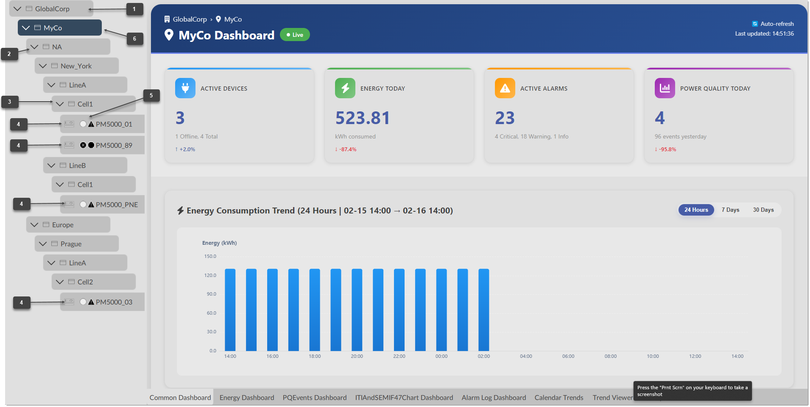

**Dashboard Layout**

```
[Your Org Tree Structure]
1. Root Org Node (top-level organization)
2. Expand/Collapse Arrow
3. Org Node Row (site/building/line)
4. Device Row (PM5000 device)
5. Device Status/Type Icons
6. Selected Node Highlight
```

**Content Table**

| # | Item | Description |
|---|------|-------------|
| 1 | **Root Org Node** | Top-level organization entry point (e.g., GlobalCorp). Expanding this shows all child sites and facilities. |
| 2 | **Expand/Collapse Arrow** | Opens or closes child levels under a node. Use this to drill down to the desired facility or device. |
| 3 | **Org Node Row** | Represents a logical group such as Site, Building, Line, or Cell. Selecting this aggregates data from all children. |
| 4 | **Device Row** | Individual PM5000 device node. Selecting this shows faceplate for that individual device. |
| 5 | **Device Status/Type Icons** | Visual status indicators next to each device (online/offline/attention) and device type icon. |
| 6 | **Selected Node Highlight** | The currently selected node is highlighted with a different color to show the active scope. |
| **Action** | **Click Org Node** | Sets scope to that org node → all dashboard tabs update to show aggregated data for devices under that node. |
| **Action** | **Click Device** | It will Open PQEM faceplate as a popup for that device. |
| **Action** | **Expand/Collapse Any Level** | Users can expand or minimize nodes at any level to navigate to the desired scope. |

**User Interaction Flow**

Select any node in the tree to load data for that node across all dashboard screens. When a parent node is selected, data is aggregated from all devices under that node. When a specific device node is selected, dashboards show only that device. Clicking a device node also opens the dedicated PQEM faceplate popup for detailed device exploration.

---

## 6.2 Common Dashboard

**Short Description**

The Common Dashboard is the executive overview—a real-time snapshot of critical power metrics aggregated across your selected org node. At a glance, see energy consumption today, active device count, active alarms, and power quality events. Dashboard updates every 30 seconds automatically. This is the starting point for identifying issues before diving into detailed analysis.

**Dashboard Layout**

```
[Common Dashboard - Real-Time Executive Overview]
1. Header: Breadcrumb Navigation + Org Node Title + "Live" Status Badge + Last Updated Time
2. KPI Cards Row (4 cards, color-coded):
   - Active Devices (Blue card with device icon)
   - Energy Today (Green card with bolt icon)
   - Active Alarms (Orange card with alert icon)
   - Power Quality Today (Purple card with chart icon)
3. Energy Consumption Trend Chart Section:
   - Chart Title with range toggle buttons (24 Hours, 7 Days, 30 Days)
   - Bar chart showing hourly energy consumption (kWh)
4. Bottom Grid (2-column layout):
   - Alarms Panel (left): Severity badges + alarm list
   - Power Quality Events Panel (right): Event types + count badges
```

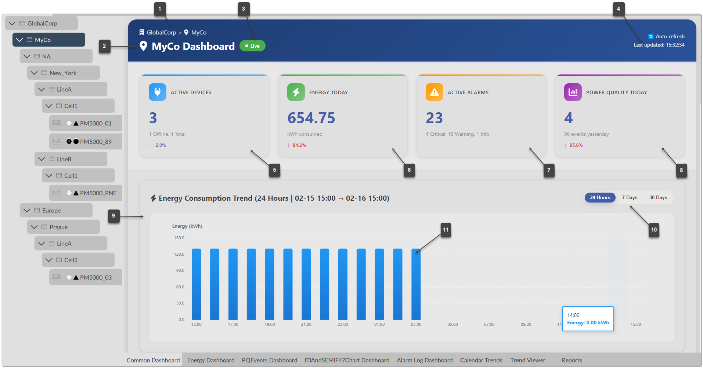
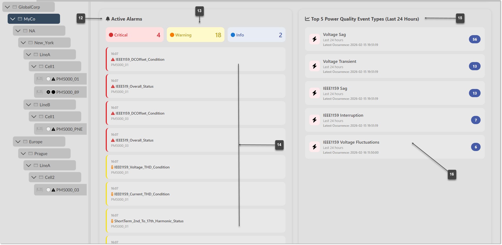

**Content Table**

| # | Item | Description |
|---|------|-------------|
| 1 | **Breadcrumb Navigation** | Hierarchical org path shown as: Factory > Facility > Building > Device. It will get updated based on node selection in org tree. Shows current scope for data aggregation. |
| 2 | **Dashboard Title** | Displays selected org node name (e.g., "MyCo Dashboard", "Building A Dashboard"). Left-aligned with location pin icon. |
| 3 | **"Live" Status Badge** | Green badge with animated pulse dot and "Live" label. Indicates real-time data refresh is active. Right-aligned in header. |
| 4 | **Last Updated Time** | Shows "Last updated: HH:mm:ss" in header right corner. Updates every 30 seconds. Helps user verify data freshness. |
| 5 | **Active Devices KPI Card** | Showing how many PM5000 meters are communicating successfully. Displays the count of Active online devices, the number of offline/unreachable devices (e.g., "1 Offline"), and total device count under this org node (e.g., "4 Total"). Includes trend arrow showing device availability change vs. yesterday (e.g., "↑ +2.0%" if more devices are online today), helping identify network or communication issues early. If any devices are offline, it signals potential monitoring gaps or equipment failures requiring attention. |
| 6 | **Energy Today KPI Card** | Tracks real-time energy consumption from midnight to present, enabling facility to monitor daily usage and project utility costs. Displays cumulative kWh consumed (e.g., "480.12 kWh consumed"). Includes trend arrow comparing today's consumption vs. yesterday (e.g., "↓ -88.4%"), showing if usage is higher or lower than typical. This helps identify unusual patterns (e.g., unexpected high consumption might indicate equipment malfunction or operational changes). |
| 7 | **Active Alarms KPI Card** | Displays total count of active alarms (e.g., "23"), with severity breakdown showing how many are Critical (require immediate action), Warning (should be monitored), and Info (informational). High critical counts (shown in red) trigger visual urgency. |
| 8 | **Power Quality Today KPI Card** | Displays total PQ events detected in the last 24 hours (e.g., "4 events"). Includes trend arrow comparing today's events vs. yesterday (e.g., "↓ -95.8%"), showing if power quality is improving or degrading. High event counts may indicate network issues, equipment faults, or utility-side problems requiring investigation in ITI/SEMI-F47 Dashboard or PQEvents Dashboard. Low or zero events confirm stable power quality. |
| 9 | **Energy Consumption Trend Chart** | Energy Consumption Trend for last 24hrs, 7 Days and 30 Days. . |
| 10 | **Range Toggle Buttons** | Allows users to shift focus between different time windows ("24 Hours", "7 Days", "30 Days") to identify patterns at different scales. 24-hour view shows hourly peaks for daily demand management; 7-day view reveals weekly patterns; 30-day view shows monthly trends for utility billing analysis. Active selection remains highlighted. Chart re-renders instantly with aggregated data for new time range. |
| 11 | **Energy Chart (Bar Chart)** | Visualizes energy consumption to identify peak usage periods and anomalies. Taller bars = higher consumption in that period; shorter bars = lower usage. Users can spot: (1) Peak consumption times (plan demand management), (2) Unusual spikes (investigate possible equipment faults or operational changes), (3) Off-peak hours (schedule maintenance or power-intensive operations). Tooltip on hover shows exact kWh for precise analysis. Data aggregates across all devices under selected org node, enabling facility-level insights. |
| 12 | **Active Alarms** | "🔔 Active Alarms". Shows section for active alarm summary for selected org node. |
| 13 | **Alarm Severity Badges** | Quickly conveys alarm urgency at a glance using color coding and counts. **Critical** (red) = immediate attention needed (voltage issues, safety risks); **Warning** (yellow) = monitor and plan corrective action soon; **Info** (blue) = informational, no immediate action. High critical count (highlighted in red) visually alerts operators to potential outages or device failures. Helps prioritize response: tackle all Critical issues first, then Warning, then Info. |
| 14 | **Alarm List** | Provides detailed timeline of individual issues by device. Shows most recent alarms first (ordered by timestamp). Each row displays: time alarm occurred, alarm type (e.g., "Over Voltage"), which device raised it, and severity indicator. Users can correlate alarm timing with operational events. |
| 15 | **Power Quality Events** | Displays the top 5 most frequent PQ Event types from the last 24 hours across all devices in the selected org node. For each event type, it shows: the event type name (e.g., Sag, Swell, Transient), the total count of occurrences, and the timestamp of the most recent occurrence. Events are sorted by frequency (highest count first) to highlight the most common power quality issues affecting your system. |
| 16 | **PQ Event Type Rows** | Prioritizes the most frequent power quality problems for quick diagnosis. Shows top 5 event categories ranked by frequency in last 24 hours. Includes timestamp of last occurrence so operators know if issue is recent (active problem) or historical (resolved). |
| **Interaction** | **Hover on Chart Bar** | Tooltip appears: date/time, exact kWh value. Stays visible while hovering. |
| **Interaction** | **Range Button Click** | Switches chart to new time window (24h → 7d → 30d). Chart re-animates with new data. Selected button remains highlighted. |


---

## 6.3 Energy Dashboard

**Short Description**

The Energy Log Dashboard provides comprehensive energy consumption and demand analytics for all power monitoring devices under the selected organizational node. Data is database-driven and on-demand—users select a time range to view historical energy data. Supports preset periods (24 hours, 7 days, 30 days) or custom date ranges.

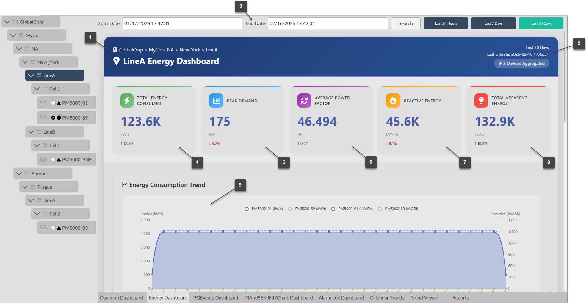
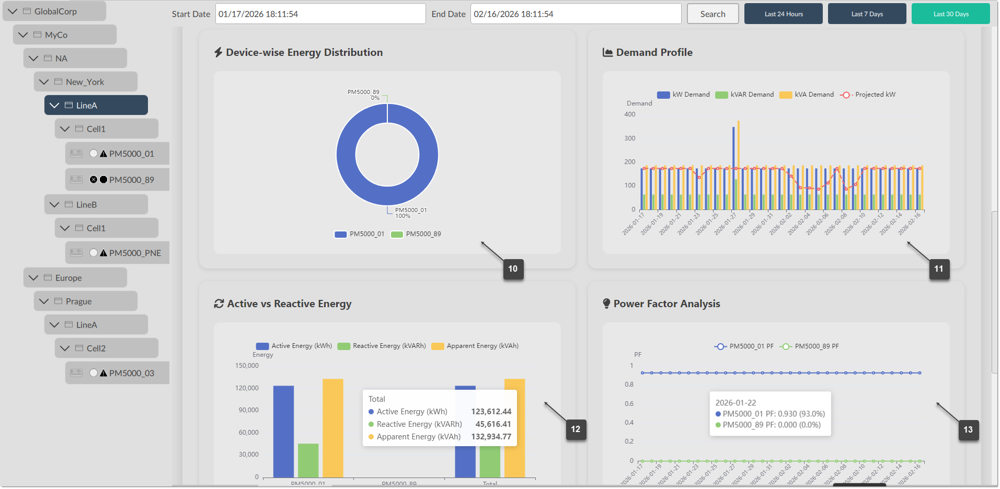
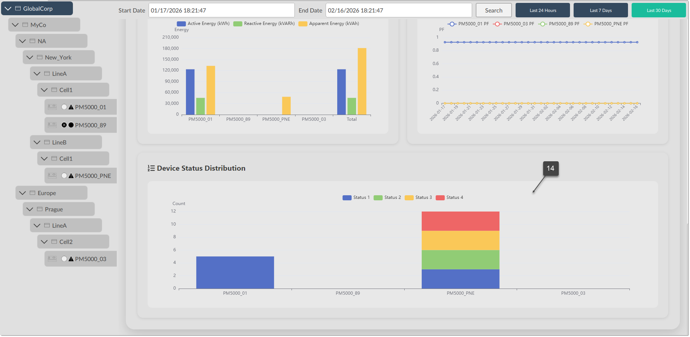

**Content Table**

| # | Item | Description |
|---|------|-------------|
| 1 | **Header Left** | Displays the dashboard title "Energy Dashboard" and the currently selected organizational node breadcrumb (e.g., `GlobalCorp > MyCo > NA > New_York > LIneA`). |
| 2 | **Header Right** | Shows the selected time range label (e.g., "Last 7 Days" or custom date range). last-updated timestamp and Device Aggregatted count. |
| 3 | **Period Selection** | Date range selector buttons: **24h**, **7d**, **30d**, and **Custom**. Controls all KPIs and charts below. Selecting a range re-queries the database and updates all visualizations. Custom option requires Star and End DateTime and hit Search button. |
| 4 | **Total Energy Consumed KPI** | Net active energy consumed across all devices under the selected organization node for the selected time period. **Calculation**: For each device, `MAX(kWh) - MIN(kWh)` (odometer-style delta), then sum all devices. Example: 3 devices consumed 1,200 + 800 + 950 = **2,950 kWh**. |
| 5 | **Peak Demand KPI** | Highest instantaneous power demand recorded across all devices under the selected organization node during the selected period. **Calculation**: `MAX(kW_Demand)` across all devices and timestamps. Identifies the peak load moment for demand charge analysis. |
| 6 | **Average Power Factor KPI** | Average demand power factor across all devices under the selected organization node . **Calculation**: Each device's `AVG(Demand_PF)`, then averaged across device count. |
| 7 | **Reactive Energy KPI** | Total reactive energy consumed across all devices under the selected organization node. **Calculation**: For each device, `MAX(kVARh) - MIN(kVARh)`, then sum all. High values signal potential power factor penalties. |
| 8 | **Total Apparent Energy KPI** | Total apparent energy (active + reactive) across all devices under the selected organization node. **Calculation**: For each device, `MAX(kVAh) - MIN(kVAh)`, then sum all. |
| 9 | **Energy Trend Chart** | Time-series line chart of kWh consumption over the selected period. **Multi-Device**: Separate line per device (e.g., `PM5000_01_kWh`, `PM5000_02_kWh`). Each device's consumption calculated as `MAX - MIN` per time slot. **Time Resolution**: 24h = hourly buckets (`HH:00`), 7+ days = daily buckets (`YYYY-MM-DD`). |
| 10 | **Device Energy Distribution** | Pie chart showing energy breakdown by device. Individual entry per device showing each device's total consumption for easy comparison. Quickly identifies which device/area consumes most energy. |
| 11 | **Demand Profile Chart** | Bar/chart of kW, kVAR, kVA demand over time. **Multi-Device**: Summed across all devices per timestamp, then `MAX` per time slot to show combined facility peak demand. Used for demand charge optimization. |
| 12 | **Active vs Reactive Energy** | Comparison chart of active (kWh), reactive (kVARh), and apparent (kVAh) energy. **Multi-Device**: Per-device bars plus a **Total** row showing individual and combined values. Visualizes power factor impact. |
| 13 | **Power Factor Trend Chart** | Line chart of power factor values over time. **Multi-Device**: Separate line per device to identify which device has poor PF requiring correction (capacitor banks, VFDs). |
| 14 | **Device Status Distribution Chart** | Distribution of operational status counters per device. Shows Status 1-4 counts individually per device. Status counters stored as two registers (`xM × 1,000,000 + x1`) and combined for display. |

**Calculation Notes**

- **Cumulative meters** (`kWh`, `kVARh`, `kVAh`): Energy values are odometer-style. Consumption = `MAX - MIN` within each time slot (actual energy used).
- **Instantaneous values** (`kW`, `kVAR`, `kVA` demand): Peak values use `MAX` per slot; facility demand uses `SUM` across devices, then `MAX`.
- **Time Resolution**: 24-hour range uses hourly buckets; 7+ day ranges use daily buckets.

**Example: 3 Devices Over 7 Days**

If org node `Building_A` contains `PM5000_01`, `PM5000_02`, `PM5000_03`:

| Metric | Calculation | Result |
|--------|-------------|--------|
| **Total Energy KPI** | `(Device1 MAX-MIN) + (Device2 MAX-MIN) + (Device3 MAX-MIN)` | Combined kWh |
| **Energy Trend Chart** | 3 separate lines, one per device | 7 data points (daily) each |
| **Demand Profile** | `SUM(all 3 devices' kW_Demand)` per day | Single combined line, MAX value displayed |
| **Active vs Reactive** | Individual + Total | 4 bars: `PM5000_01`, `PM5000_02`, `PM5000_03`, `Total` |

---

## 6.4 PQEvents Dashboard

**Short Description**

The Power Quality Events Dashboard aggregates all PQ disturbances (sags, swells, transients, interruptions, harmonics) detected by PM5000 meters under the selected organizational node. Data is database-driven and on-demand—users select a time range to analyze historical power quality events. The dashboard provides event summaries grouped by type, frequency trends over time, duration analysis, and a detailed event log with waveform availability indicators.


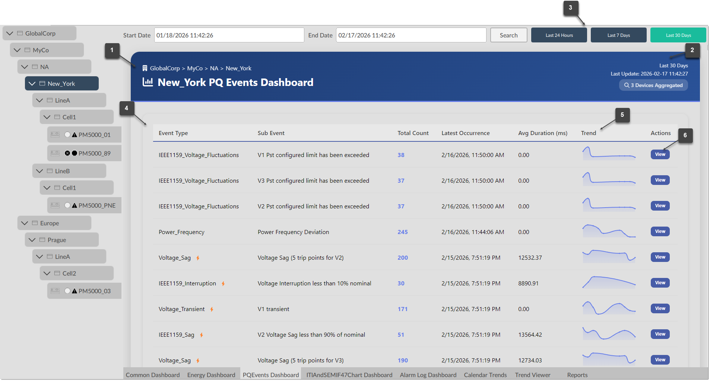
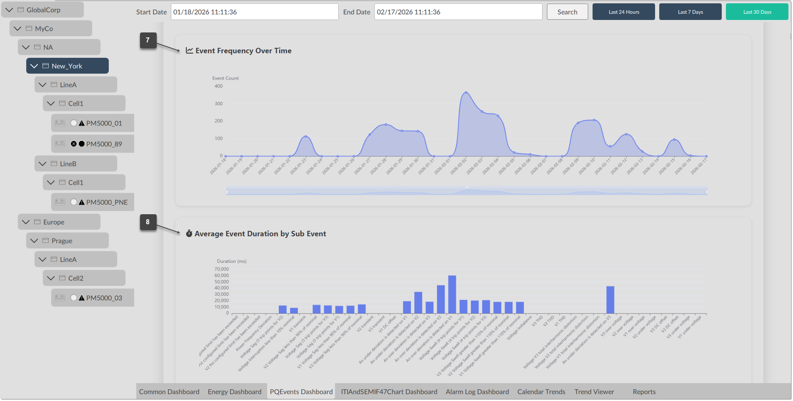
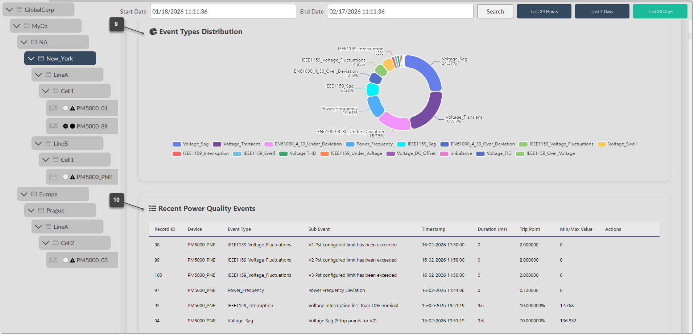
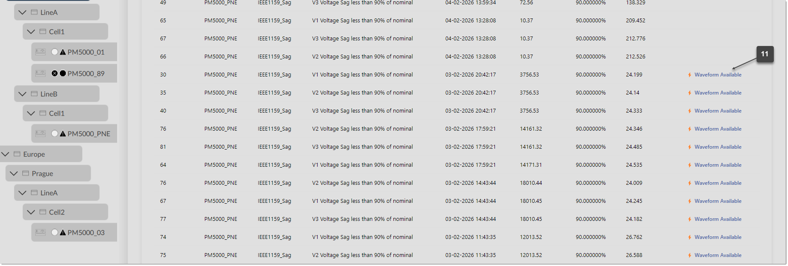

**Content Table**

| # | Item | Description |
|---|------|-------------|
| 1 | **Header Left** | Displays the dashboard title "PQ Events Dashboard" and the currently selected organizational node breadcrumb (e.g., `GlobalCorp > MyCo > NA > New_York`). Shows the scope for data aggregation. |
| 2 | **Header Right** | Shows the selected time range (e.g., "Last 30 Days"), last update timestamp, and aggregation badge displaying "X Devices Aggregated" to indicate how many PM5000 meters are included in the data. |
| 3 | **Period Selection** | Date range selector buttons: **24h**, **7d**, **30d**, and **Custom**. Controls all summary tables and charts below. Selecting a range re-queries the database and updates all visualizations. |
| 4 | **Event Summary Table** | Aggregated summary of all PQ events grouped by **Event Type** and **Sub Event**. Columns: Event Type (e.g., Sag, Swell, Transient), Sub Event (e.g., V1 transient, Power Frequency Deviation), Total Count, Latest Occurrence timestamp, Average Duration (ms), inline Trend sparkline chart, and View button. Events from all devices under the selected org node are combined and grouped. Also The summary table now shows a ⚡ waveform icon next to event types that have associated waveforms.|
| 5 | **Trend Sparkline** | Mini line chart in each summary row showing event frequency over the selected period. Visualizes whether this event type is increasing, decreasing, or stable. Helps identify recurring patterns or recent spikes. |
| 6 | **View Button** | Filters the Recent Events Table (item 10) to show only events of that specific Event Type. Scrolls to the events table automatically. Allows quick drill-down into specific event categories. |
| 7 | **Event Frequency Over Time Chart** | Time-series line/area chart showing total daily event count across the selected period. X-axis: dates; Y-axis: event count. Shows temporal patterns—identify days with high disturbance activity. Includes data zoom slider for panning/zooming. **Multi-Device**: Displays combined total count from all devices. |
| 8 | **Average Event Duration by Sub Event Chart** | Horizontal bar chart showing average duration (in milliseconds) for each Sub Event type. Helps identify which disturbance types last longest and may cause the most equipment stress. **Multi-Device**: Averages duration across all devices for each sub-event type. |
| 9 | **Event Types Distribution Chart** | Donut/pie chart showing percentage breakdown of event types (e.g., Sag 45%, Swell 30%, Transient 15%, Interruption 10%). Visualizes which categories dominate power quality issues. **Multi-Device**: Shows combined percentage distribution from all devices. |
| 10 | **Recent Power Quality Events Table** | Detailed log of individual PQ events with columns: Record ID, Device Name, Event Type, Sub Event, Timestamp, Duration (ms), Trip Point (threshold that triggered event), Min/Max Value (measured voltage), and Actions. Events from all devices are listed with the Device column identifying the source. Sorted by timestamp (most recent first). |
| 11 | **Waveform Indicator** | In the Actions column, events with captured waveform data display "⚡ Waveform Available" indicator. Indicates that detailed waveform analysis is available for that event in the Historical Waveform Viewer. |

**Multi-Device Behavior**

When multiple PM5000 devices exist under the selected org node, events from all devices are combined and grouped by Event Type + Sub Event in the summary table. Charts display aggregated totals (event frequency, duration averages, type distribution) across all devices, while the events table lists individual records with a Device column identifying the source. The header shows an "X Devices Aggregated" badge indicating the scope.

**Automatic Refresh**

The dashboard automatically updates based on these triggers:

| Trigger | What Happens |
|---------|--------------|
| **New PQ Event Detected** | Dashboard refreshes immediately when any device logs a new event (via NewEventTrigger subscription in backend) |
| **Org Node Changed** | Dashboard reloads data for the newly selected node |
| **Time Range Changed** | Dashboard queries database for new date range and updates all visualizations |
| **Periodic Refresh** | Auto-refreshes every 5 minutes to catch any missed updates |

---

## 6.5 ITI And SEMI-F47 Chart Dashboard

**Short Description**

The ITI and SEMI-F47 Chart Dashboard plots power quality voltage events (('IEEE1159_Swell', 'IEEE1159_Sag', 'Voltage_Swell', 'Voltage_Sag')) against IEEE 1159 ITI and SEMI F47 (semiconductor industry) voltage tolerance curves. This visualization helps determine whether detected events fall within acceptable equipment tolerance limits or pose a risk to sensitive equipment. Data is database-driven and on-demand—users select a time range to analyze historical events. The dashboard aggregates events from all PM5000 devices under the selected org node and plots them on a single compliance chart.

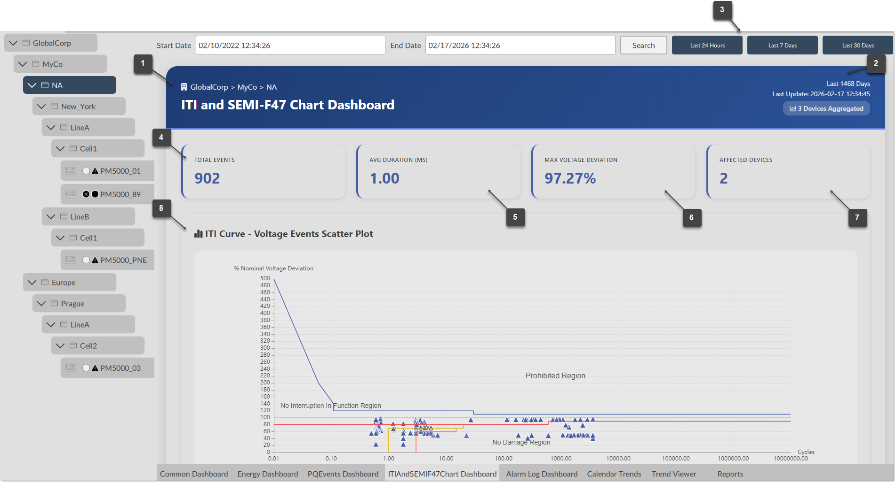
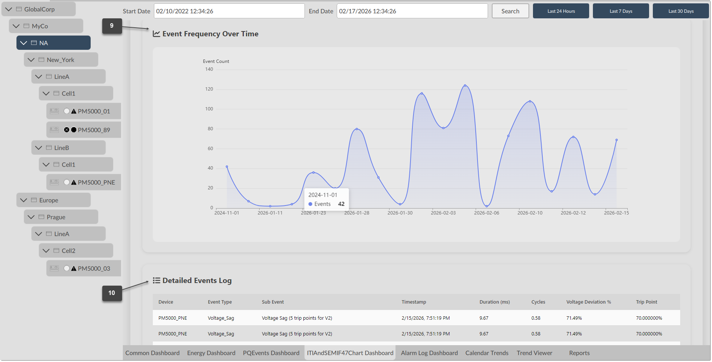

**Content Table**

| # | Item | Description |
|---|------|-------------|
| 1 | **Header Left** | Displays the dashboard title "ITI and SEMI-F47 Chart Dashboard" and the currently selected organizational node breadcrumb (e.g., `GlobalCorp > MyCo > NA > New_York`). Shows the scope for data aggregation. |
| 2 | **Header Right** | Shows the selected time range (e.g., "Last 7 Days"), last update timestamp, and aggregation badge displaying "X Devices Aggregated" to indicate how many PM5000 meters are included in the data. |
| 3 | **Period Selection** | Date range selector buttons: **24h**, **7d**, **30d**, and **Custom**. Controls all KPIs, charts, and tables below. Selecting a range re-queries the database for `IEEE1159_Swell`, `IEEE1159_Sag`, `Voltage_Swell`, `Voltage_Sag` events and updates all visualizations. Custom option opens date pickers for specific start/end dates. |
| 4 | **Total Events KPI** | Count of all voltage sag/swell events detected across all devices in the selected period. Indicates overall PQ disturbance frequency. Higher counts warrant deeper investigation into root causes. |
| 5 | **Avg Duration KPI** | Average duration (in milliseconds) of all detected events. Longer durations may indicate more severe disturbances. Helps assess the typical severity of PQ issues in your facility. |
| 6 | **Max Voltage Deviation KPI** | The highest voltage deviation percentage recorded among all events. Shows the worst-case disturbance severity. High values (e.g., >50%) indicate events that may have impacted equipment operation. |
| 7 | **Affected Devices KPI** | Count of unique PM5000 devices that recorded voltage events. Helps identify if disturbances are localized (1 device) or facility-wide (multiple devices). |
| 8 | **ITI Curve Scatter Plot** | The main compliance chart. **X-axis**: Event duration in cycles (logarithmic scale, 0.01 to 10,000,000). **Y-axis**: Voltage deviation as percentage of nominal (0–500%). Events are plotted as triangle markers. Reference curves divide the chart into regions: **Prohibited Region** (above upper curve—equipment damage likely), **No Damage Region** (between curves—equipment survives), **No Interruption In Function Region** (below lower curve—equipment continues normal operation). |
| 9 | **Event Frequency Over Time Chart** | Line/area chart showing daily event counts over the selected period. X-axis: dates; Y-axis: event count. Identifies days with high PQ disturbance activity. **Multi-Device**: Combined total count from all devices per day. |
| 10 | **Detailed Events Log Table** | Full list of all voltage events with columns: Device Name, Event Type (IEEE1159_Sag, IEEE1159_Swell, etc.), Sub Event (phase detail), Timestamp, Duration (ms), Cycles, Voltage Deviation %, Trip Point (threshold that triggered detection). Sorted by timestamp (most recent first). **Multi-Device**: Lists events from all devices with Device column identifying the source. |

**Multi-Device Behavior**

When multiple PM5000 devices exist under the selected org node, all voltage sag/swell events are aggregated onto a single ITI curve scatter plot. KPIs show combined totals (sum of events, max deviation from any device, count of affected devices). The events table lists all records with a Device column identifying the source, and the header displays an "X Devices Aggregated" badge.

**Automatic Refresh**

The dashboard automatically updates based on these triggers:

| Trigger | What Happens |
|---------|--------------|
| **Org Node Changed** | Dashboard reloads data for the newly selected node |
| **Time Range Changed** | Dashboard queries database for new date range and updates all visualizations |

**ITI/SEMI-F47 Curve Regions Explained**

| Region | Location on Chart | Meaning |
|--------|-------------------|---------|
| **Prohibited Region** | Above ITI upper curve | Voltage too high for too long—likely equipment damage or malfunction |
| **No Damage Region** | Between upper and lower curves | Equipment survives the disturbance without physical damage |
| **No Interruption In Function Region** | Within SEMI-F47 tolerance zone | Semiconductor equipment continues operation without process interruption |

---

## 6.6 Alarm Log Dashboard

**Short Description**

The Alarm Log Dashboard aggregates device-generated alarms from all PM5000 meters under the selected organizational node. It displays alarm counts by severity (Critical, Warning, Info), identifies the top offending device, shows alarm type distribution, and provides a temporal trend chart for pattern analysis. Data is database-driven and on-demand—users select a time range to view historical alarm data.
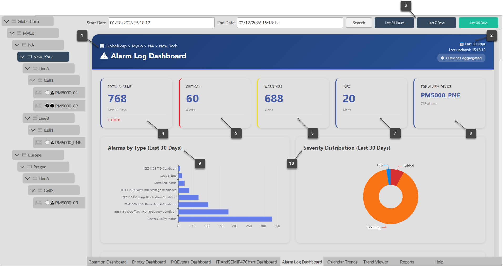
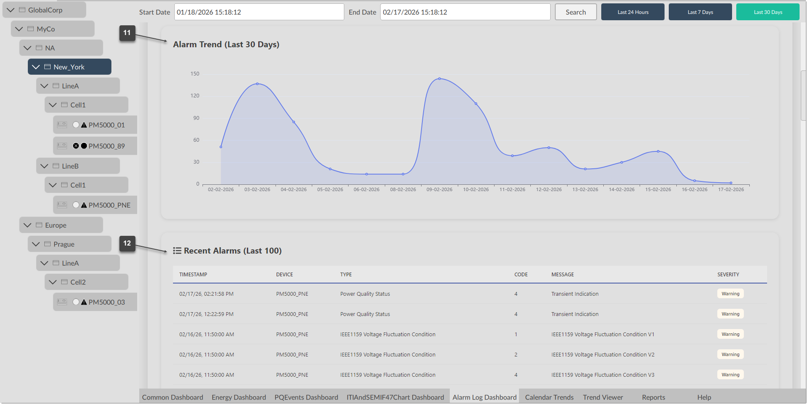

**Content Table**

| # | Item | Description |
|---|------|-------------|
| 1 | **Header Left** | Displays the dashboard title "Alarm Log Dashboard" and the currently selected organizational node breadcrumb (e.g., `GlobalCorp > MyCo > NA > New_York`). Shows the scope for data aggregation. |
| 2 | **Header Right** | Shows the selected time range (e.g., "Last 30 Days"), last update timestamp, and aggregation badge displaying "X Devices Aggregated" to indicate how many PM5000 meters are included in the data. |
| 3 | **Period Selection** | Date range selector buttons: **24h**, **7d**, **30d**, and **Custom**. Controls all KPIs, charts, and tables below. Selecting a range re-queries the database and updates all visualizations. |
| 4 | **Total Alarms KPI** | Count of all alarms recorded across all devices in the selected period. Displays trend indicator (↑/↓) comparing current period vs. previous period of same duration. |
| 5 | **Critical KPI** | Count of Critical severity alarms (red-highlighted). These require immediate attention—voltage issues, safety risks, equipment failures. High critical counts trigger visual urgency. |
| 6 | **Warnings KPI** | Count of Warning severity alarms (orange-highlighted). These should be monitored and addressed soon to prevent escalation to critical issues. |
| 7 | **Info KPI** | Count of Informational severity alarms (blue-highlighted). These are non-urgent notifications such as configuration changes, mode transitions, or maintenance reminders. |
| 8 | **Top Alarm Device KPI** | Identifies the PM5000 device generating the most alarms in the selected period. Displays device name and alarm count. Helps pinpoint problematic equipment for focused troubleshooting. |
| 9 | **Alarms by Type Chart** | Horizontal bar chart showing alarm count breakdown by alarm type (e.g., Over Voltage, Under Voltage, Communication Fault). Sorted by count. Identifies the most frequent alarm categories. **Multi-Device**: Aggregates alarm types from all devices. |
| 10 | **Severity Distribution Chart** | Donut/pie chart showing percentage breakdown: Critical (red), Warning (orange), Info (blue). Visualizes the overall severity mix—high Critical percentage indicates system stress. **Multi-Device**: Combined distribution from all devices. |
| 11 | **Alarm Trend Chart** | Line/area chart showing alarm count per day over the selected period. X-axis: dates; Y-axis: alarm count. Shows temporal patterns—identify days with high alarm activity and correlate with operational events. **Multi-Device**: Combined daily count from all devices. |
| 12 | **Recent Alarms Table** | Detailed log of individual alarms with columns: Timestamp, Device Name, Type (alarm category), Code (alarm code), Message (description), Severity (badge: Critical/Warning/Info). Shows last 100 alarms, sorted by timestamp (most recent first). **Multi-Device**: Lists alarms from all devices with Device column identifying the source. |

**Multi-Device Behavior**

When multiple PM5000 devices exist under the selected org node, alarms from all devices are aggregated into unified KPIs and charts. The Total Alarms KPI shows the combined count, while the Top Alarm Device KPI identifies which device is generating the most issues. Charts show aggregated data across all devices, and the Recent Alarms table lists individual records with a Device column identifying the source. The header displays an "X Devices Aggregated" badge.

**Automatic Refresh**

When the org node changes, the dashboard reloads data for the newly selected scope. When the time range changes, the dashboard queries the database for the new date range and updates all visualizations.

---

## 6.7 Calendar Trends Dashboard

**Short Description**

The Calendar Trends Dashboard visualizes any selected parameter as a calendar heatmap with daily sparkline charts. Users select a **Tag** (parameter), **Month**, and **Year** to view high-resolution daily patterns across all devices under the selected org node. Each calendar day displays a 24-hour sparkline showing 96 data points (15-minute intervals), enabling quick identification of daily patterns, anomalies, and operational variations. When user clicks any day cell, it opens a detailed statistics panel showing Min, Max, Avg, Variance, and a full-size hourly trend chart for that day.

**Database Integration**: Data is pulled from two SQLite database tables:
- **DataLogger_AllDevices**: Contains real-time logged parameters—any numeric column in this table is available as a selectable tag
- **EnergyLog_AllDevices**: Contains fixed energy parameters including: `kW_Demand`, `kVAR_Demand`, `kVA_Demand`, `Demand_PF`, `Projected_kW_Demand`, `Projected_kVAR_Demand`, `Projected_kVA_Demand`, `Total_kWh_Fwd`, `Total_kWh_Rev`, `Total_kWh_Net`, `Total_kVARh_Fwd`, `Total_kVARh_Rev`, `Total_kVARh_Net`, `Total_kVAh`

All available tags are merged, deduplicated, and presented in an alphabetically sorted dropdown for user selection.

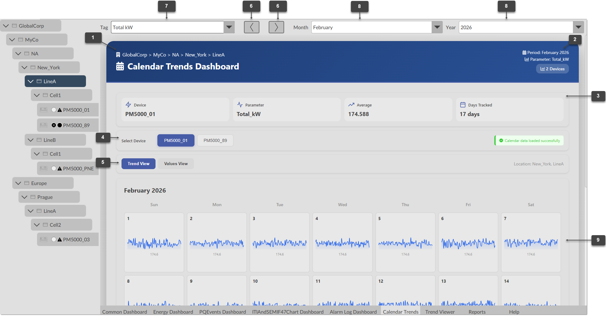
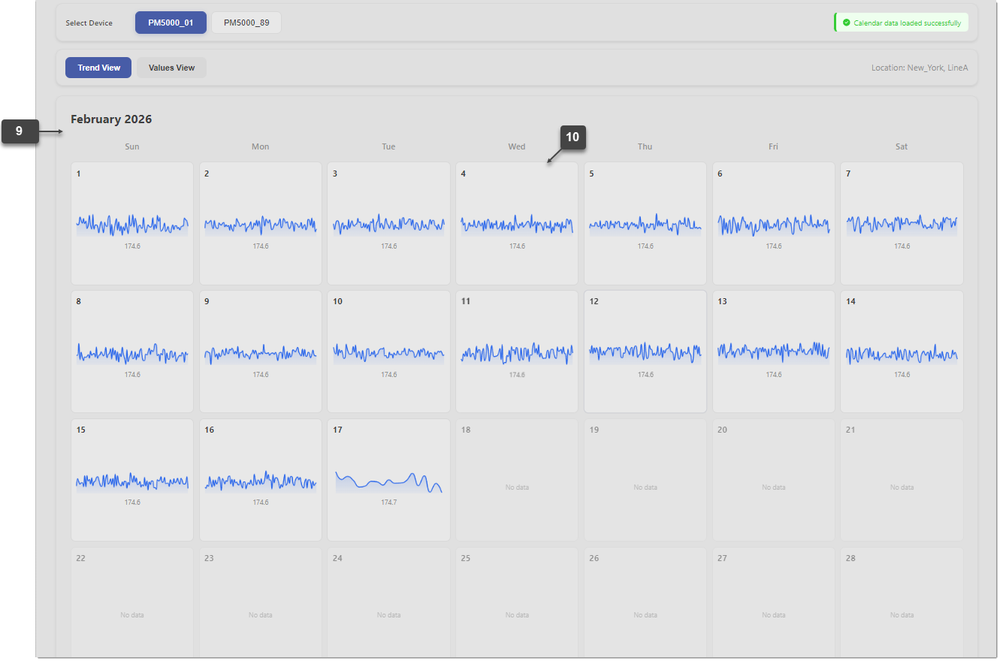
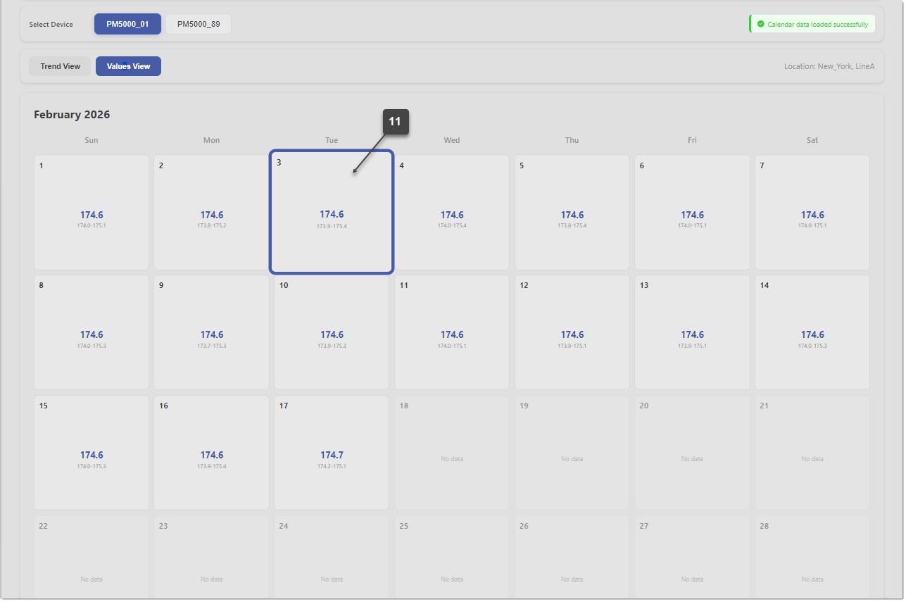
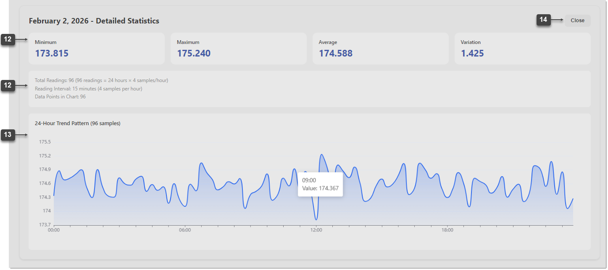

**Content Table**

| # | Item | Description |
|---|------|-------------|
| 1 | **Header Left** | Displays the dashboard title "Calendar Trends Dashboard" and the currently selected organizational node breadcrumb (e.g., `GlobalCorp > MyCo > NA > New_York`). Shows the scope for data aggregation. |
| 2 | **Header Right** | Shows the selected period (e.g., "December 2025"), selected parameter/tag name, and aggregation badge displaying "X Devices" to indicate how many PM5000 meters are included. |
| 3 | **KPI Cards Row** | Four info cards showing: **Device Name** (currently displayed device), **Tag Name** (selected parameter), **Total kW**, **Total Days** (number of days with data in the month). |
| 4 | **Device Selector** | Row of buttons to switch between devices when multiple PM5000s exist under the selected org node. Click a device button to view that device's calendar data. Active device is highlighted. These buttons gets automatically added when user changes org node. |
| 5 | **View Mode Toggle** | Two buttons: **Sparkline View** (shows 24-hour sparkline per day) and **Values View** (shows numeric min/max/avg per day). Allows switching between visual and numeric representations. |
| 6 | **Month Navigation** | **Previous** and **Next** buttons to browse months. Updates comboboxes and auto-reloads calendar data for the new month. |
| 7 | **Tag Selector** | Dropdown to select which parameter to visualize. Options include all numeric columns from `DataLogger_AllDevices` plus fixed energy tags from `EnergyLog_AllDevices`. Changing the tag re-queries the database and redraws the calendar. |
| 8 | **Month/Year Selectors** | Dropdown comboboxes for selecting month (January–December) and year (current year plus 10 previous years). Changing selection triggers data reload. |
| 9 | **Calendar Grid** | 7-column × N-row calendar layout (Sunday–Saturday). Each cell represents one day of the selected month. Empty cells for days outside the month are invisible. |
| 10 | **Day Cell - Sparkline View** | Each day shows: day number, a miniature 24-hour sparkline chart (96 data points at 15-minute intervals and it is again based on what interval data is logginng), and average value below. Sparkline visualizes the daily profile—peaks, valleys, and patterns are instantly visible. |
| 11 | **Day Cell - Values View** | When Values View is selected, each day shows: day number, average value prominently displayed, and min–max range below. Provides quick numeric comparison across days. |
| 12 | **Day Details Panel** | When a day is clicked, expands to show detailed statistics: **Min**, **Max**, **Avg**, **Variance** (Max - Min), total readings count, and a full-size hourly trend chart with tooltips. Includes a Close button to collapse the panel. |
| 13 | **Detail Trend Chart** | Full-width line chart showing the selected day's 96 data points over 24 hours. X-axis shows time (0:00–24:00), Y-axis shows parameter value. Hover for precise timestamps and values. |
| 14 | **Close Button** | It will close detailed chart panel |

**Multi-Device Behavior**

When multiple PM5000 devices exist under the selected org node, the Device Selector displays buttons for each device. Users view one device at a time—click a device button to switch. KPI cards and calendar update to show that device's data. The header badge shows the total device count available.

**Automatic Refresh**

The dashboard reloads data when the org node changes in the navigation tree. Month/Year navigation and Tag selection each trigger a database re-query and calendar redraw. The WebBrowser component is refreshed after each data update.

**Data Resolution**

| Data Source | Resolution | Points per Day |
|-------------|------------|----------------|
| DataLogger_AllDevices | 15-minute intervals | 96 readings |
| EnergyLog_AllDevices | 15-minute intervals | 96 readings |

---

## 6.8 Trend Viewer Dashboard

**Short Description**

The Trend Viewer is a multi-parameter, multi-device historical analyzer. Select up to **5 tags** (parameters) and multiple devices to visualize correlated trends over custom date ranges with independent Y-axis scaling per tag. Each selected tag gets its own Y-axis, allowing comparison of parameters with different units and scales (e.g., voltage in V vs. current in A vs. power in kW) on a single chart. Essential for debugging transient events, correlating equipment behavior, or verifying load management strategies.

**Database Integration**: Data is pulled from two SQLite database tables:
- **DataLogger_AllDevices**: Contains real-time logged parameters—any numeric column is available as a selectable tag
- **EnergyLog_AllDevices**: Contains fixed energy parameters including: `kW_Demand`, `kVAR_Demand`, `kVA_Demand`, `Demand_PF`, `Projected_kW_Demand`, `Projected_kVAR_Demand`, `Projected_kVA_Demand`, `Total_kWh_Fwd`, `Total_kWh_Rev`, `Total_kWh_Net`, `Total_kVARh_Fwd`, `Total_kVARh_Rev`, `Total_kVARh_Net`, `Total_kVAh`

All available tags are merged and presented as checkboxes for user selection (maximum 5 tags allowed).

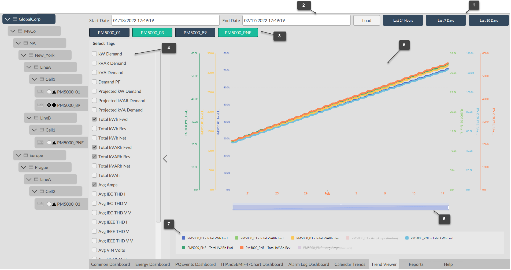
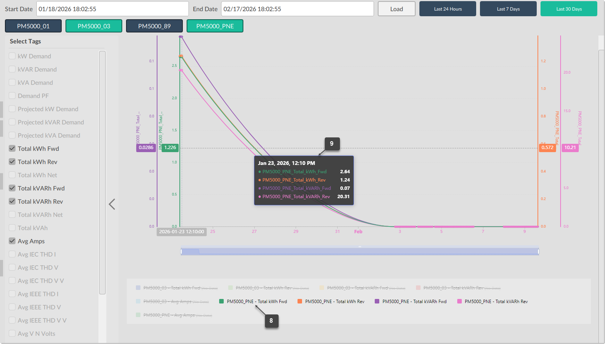

**Content Table**

| # | Item | Description |
|---|------|-------------|
| 1 | **Period Selection Buttons** | Quick-select buttons: **24h**, **7d**, **30d**. Clicking a button sets the time range and triggers data export. |
| 2 | **Custom Date Range** | Start Date/Time and End Date/Time pickers for custom time ranges. Use "Load" button to apply the custom range. |
| 3 | **Device Selection Buttons** | Row of toggle buttons for each PM5000 device under the selected org node. Click to select/deselect devices. Multiple devices can be selected simultaneously. Active devices are highlighted. THese device selection buttons gets automatically added when org node selection changes|
| 4 | **Tag Selection Checkboxes** | List of available parameters as checkboxes. Tags are sourced from both `DataLogger_AllDevices` and `EnergyLog_AllDevices` tables. **Maximum 5 tags** can be selected, once 5 tag selected other tags checkboxes gets disabled; |
| 5 | **Main Trend Chart** | **Multi-axis line chart**. X-axis: time (from start to end date). Each selected tag gets its own Y-axis (alternating left/right sides) with independent scaling. Each device + tag combination = unique colored line. Axes are color-coded to match their series lines for easy identification. |
| 6 | **Data Zoom Slider** | Horizontal slider below the chart for panning and zooming the time range. Drag edges to narrow the view; drag center to pan. Mouse scroll inside chart also zooms. |
| 7 | **Legend Container** | Displays all series with color markers. Format: "DeviceName - TagName" (e.g., "PM5000_01 - kW_Demand"). Tags without data show "(No Data)" suffix with muted styling. Click legend item to toggle series visibility. |
| 8 | **Series Visibility Toggle** | Clicking a legend item toggles that series line on/off. Disabled series show with reduced opacity. Useful when too many series clutter the view. |
| 9 | **Tooltip** | On hover, shows crosshair and tooltip with timestamp and values for all visible series at that time point. Format: "DeviceName - TagName: Value". |
| **Interaction** | **Click Period Button** | Sets time range (24h/7d/30d from now), fetches data, and refreshes chart automatically. |
| **Interaction** | **Select Device/Tag** | Checking/unchecking devices or tags updates the selection. Click "Load" or a period button to regenerate chart with new selections with new period. |
| **Interaction** | **Drag to Zoom** | Use the data zoom slider or mouse scroll to zoom into specific time ranges. Double-click chart to reset zoom. |
| **Interaction** | **Toggle Legend** | Click any legend item to show/hide that series. Helps focus on specific device/tag combinations. |

**Multi-Device Behavior**

When multiple PM5000 devices are selected, each device + tag combination becomes a separate series on the chart (e.g., selecting 2 devices and 3 tags creates 6 series). Each tag maintains its own Y-axis regardless of how many devices are selected, ensuring proper scaling. The legend clearly identifies each series with "DeviceName - TagName" format. Series without data in the selected time range appear in the legend with "(No Data)" indicator but are not plotted.

**Automatic Refresh**

The dashboard reloads data when the org node changes in the navigation tree. Selecting a new time period (24h/7d/30d buttons) or applying a custom date range triggers a database query and chart refresh. The chart also refreshes when device or tag selections change and the user initiates an load.

---

## 6.9 Reports

**Short Description**

The Reports section enables on-demand and scheduled generation of energy reports in PDF format. Reports are scoped to the currently selected org node and include energy KPIs, demand charts, and consumption analysis. Manual reports can be generated instantly using preset time periods, while scheduled reports run automatically at configured intervals (Daily, Weekly, or Monthly) and are saved to the configured Reports storage path.

**Report Storage Configuration**

The report storage location is configured via the `Cfg_ReportsStoragePath` variable located at:
`raC_4_01_raC_Dvc_PM5000_PQEMDashboard_Model > Cfg_ReportsStoragePath`

| Storage Option | Description |
|----------------|-------------|
| `%APPLICATIONDIR%` | Panel internal memory (default). Limited capacity (~2-5GB depending on panel model). Reports saved to `%APPLICATIONDIR%/Reports/` folder. |
| `%USB1%` | First USB drive. External storage with larger capacity. Useful for long-term archival or when panel memory is limited. |
| `%USB2%` | Second USB drive. Available if multiple USB ports exist on the device. |
| `\\192.168.1.100\Reports\` | Network shared path. Store reports on a shared folder accessible over the network. Format: `\\[IP_Address]\[ShareName]\`. **Note**: Network path storage is supported on Desktop deployments only; not available on Optix Panel hardware. |

**Report Output**: Reports are generated as PDF files and saved to the configured storage path under a `/Reports/` subfolder. File naming format: `EnergyReport_[OrgName]_[Period]_[Timestamp].pdf`. Reports include energy KPIs (Total Energy, Peak Demand, Power Factor), trend charts, and device distribution analysis.

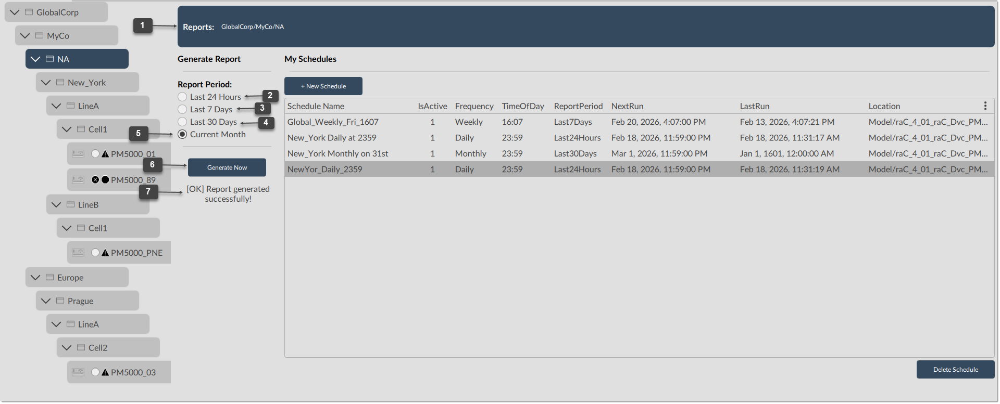

**Generate Report Panel**

| # | Item | Description |
|---|------|-------------|
| 1 | **Header** | Displays "Reports:" followed by the currently selected organizational node path (e.g., `GlobalCorp/MyCo/NA/New_York`). The report will be generated for all devices under this org node. |
| 2 | **Report Period - Last 24 Hours** | Radio button option. Generates report covering the previous 24 hours from current time. Ideal for daily operational reviews. |
| 3 | **Report Period - Last 7 Days** | Radio button option. Generates report covering the previous 7 days. Good for weekly summaries and trend analysis. |
| 4 | **Report Period - Last 30 Days** | Radio button option. Generates report covering the previous 30 days. Common for monthly utility billing and board reporting. |
| 5 | **Report Period - Current Month** | Radio button option. Generates report from the 1st of the current month to present day. Useful for month-to-date analysis. |
| 6 | **Generate Now Button** | Triggers immediate report generation for the selected org node and time period. Shows status message upon completion. PDF is saved to the Reports folder. |
| 7 | **Status Message** | Displays generation result: "[OK] Report generated successfully!" or error message if generation failed. Appears below the Generate Now button and auto-hides after 5 seconds. |
| **Interaction** | **Select Period + Generate** | Choose a report period radio button, then click "Generate Now". Report is created and saved to the application's Reports folder. |

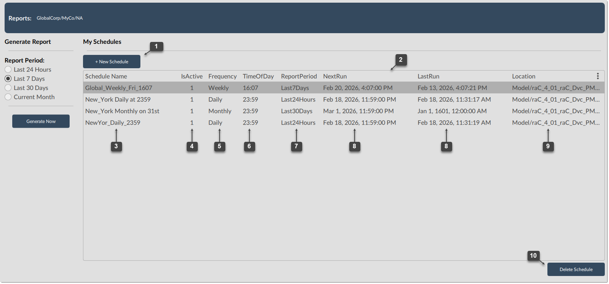

**Content Table - My Schedules Panel**

| # | Item | Description |
|---|------|-------------|
| 1 | **+ New Schedule Button** | Opens the schedule creation dialog. Pre-populates with the currently selected org node location. |
| 2 | **Schedules DataGrid** | Lists all configured report schedules. Columns: **Schedule Name**, **IsActive** (1 = active, 0 = paused), **Frequency** (Daily/Weekly/Monthly), **TimeOfDay** (HH:mm), **ReportPeriod** (Last24Hours/Last7Days/Last30Days), **NextRun** (next scheduled execution), **LastRun** (last execution timestamp), **Location** (org node path). |
| 3 | **Schedule Name Column** | User-defined identifier for the schedule (e.g., "New_York Daily at 2359", "Global_Weekly_Fri_1607"). Auto-generated if left blank. |
| 4 | **IsActive Column** | Shows 1 (active) or 0 (paused). Active schedules execute automatically at their configured times. Paused schedules are skipped until reactivated. |
| 5 | **Frequency Column** | Shows "Daily", "Weekly", or "Monthly". Determines how often the report runs. |
| 6 | **TimeOfDay Column** | The time (24-hour format) when the scheduled report executes. Example: "23:59" for end-of-day reports, "16:07" for afternoon reports. |
| 7 | **ReportPeriod Column** | Shows Report Period: Last24Hours/Last7Days/Last30Days. |
| 8 | **NextRun / LastRun Columns** | **NextRun**: Calculated next execution date/time. **LastRun**: Timestamp of most recent execution (shows "Jan 1, 1601" if never run). |
| 9 | **Location Columns** | Shows current shedule location on which report will be generated. |
| 10 | **Delete Schedule Button** | Removes the selected schedule from the list. Schedule must be selected in the grid first. Permanently deletes—cannot be undone. |
| **Interaction** | **Select Schedule Row** | Click a row in the grid to select it. Required before clicking Delete Schedule. |

**New Schedule Dialog** : Click + New Schedule button to open Schedule Dialog where you can define all shedule parameters and save new schedule

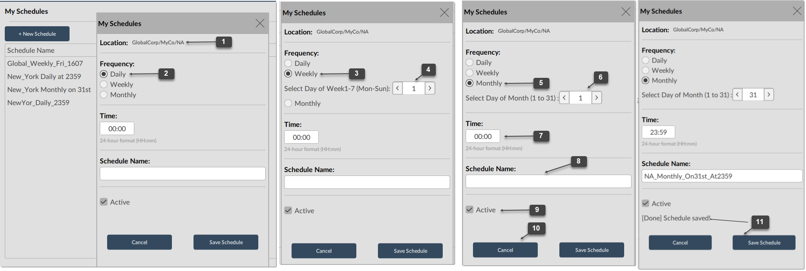

| # | Item | Description |
|---|------|-------------|
| 1 | **Location** | Read-only field showing the org node path this schedule applies to (e.g., `GlobalCorp/MyCo/NA/New_York`). Inherited from current selection when dialog opens. |
| 2 | **Frequency - Daily** | Radio button. Report runs every day at the specified time. Report period automatically set to "Last24Hours". |
| 3 | **Frequency - Weekly** | Radio button. When the Weekly radio button is selected, the report will run once per week. A “**Select Day of Week1-7 (Mon–Sun)**” spin box will appear, allowing the user to choose the specific day the report should be scheduled. The report period is automatically set to **Last 7 Days**. |
| 4 | **Day of Week Spin Box** | Appears when Weekly is selected. Values 1-7 where 1 = Monday, 7 = Sunday. Sets which day of the week the report runs. |
| 5 | **Frequency - Monthly** | Radio button. Report runs once per month. Shows "Select Day of Month (1 to 31)" spin box. Report period automatically set to "Last30Days". |
| 6 | **Day of Month Spin Box** | Displayed when the **Monthly** option is selected. Allows users to choose a day between 1 and 31 to schedule the report. If the selected day does not exist in a given month (e.g., the 31st in February), the report will run on the last day of that month instead.|
| 7 | **Time Input** | 24-hour format time picker (HH:mm). Sets the time of day when the scheduled report executes. Example: "00:00" for midnight, "23:59" for end of day. |
| 8 | **Schedule Name Input** | Optional text field for naming the schedule. If left blank, auto-generates name (e.g., "New_York_Daily_2359"). |
| 9 | **Active Checkbox** | When checked, schedule is active and will execute at configured times. Uncheck to pause the schedule without deleting it. |
| 10 | **Cancel Button** | Closes dialog without saving. No schedule is created. |
| 11 | **Save Schedule Button** | Validates inputs and creates the schedule. Schedule appears in the Schedules DataGrid immediately. NextRun is calculated automatically based on frequency and time. |
| **Interaction** | **Create Daily Schedule** | Select Daily → Set Time → (Optional) Enter Name → Check Active → Save Schedule. |
| **Interaction** | **Create Weekly Schedule** | Select Weekly → Set Day of Week (1-7) → Set Time → (Optional) Enter Name → Check Active → Save Schedule. |
| **Interaction** | **Create Monthly Schedule** | Select Monthly → Set Day of Month (1-31) → Set Time → (Optional) Enter Name → Check Active → Save Schedule. |

**Schedule Execution**

The report scheduler runs automatically in the background, checking every 60 seconds for schedules that need to execute. When a schedule's NextRun time is reached:

1. Report is generated for the configured org node and time period
2. PDF is saved to the configured storage path (see `Cfg_ReportsStoragePath` above)
3. LastRun timestamp is updated
4. NextRun is recalculated for the next occurrence


**Report Template Contents**

Each generated PDF report includes the following sections:

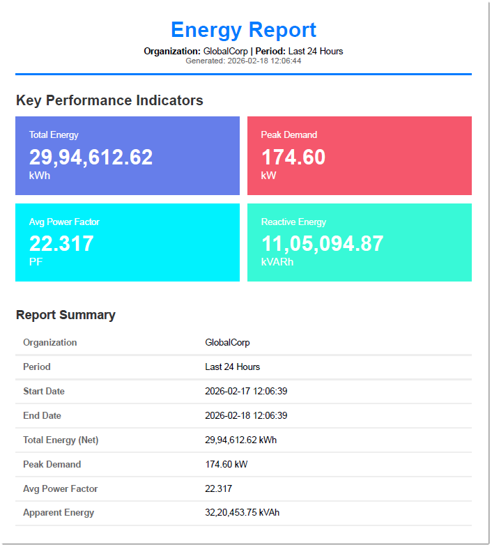

| Section | Description |
|---------|-------------|
| **Header** | Organization name, report period (e.g., "Last 7 Days") and generation timestamp. |
| **Energy KPIs** | Five key metrics displayed prominently: **Total Energy** (kWh), **Peak Demand** (kW), **Average Power Factor**, **Reactive Energy** (kVARh), **Apparent Energy** (kVAh). |
| **Date Range** | Start and end timestamps showing the exact period covered by the report. |

**File Output**: Reports are saved as PDF files with naming format:
`Report_[OrgName]_[Frequency]_[YYYYMMDD_HHMMSS].pdf`

Example: `Report_New_York_Daily_20260217_235900.pdf`

---

## 6.10 Help


The Help tab provides comprehensive documentation and reference information for the PowerMonitor™ 5000 Power Quality & Energy Monitoring Advanced Multi-Device Dashboard (`raC_4_01_raC_Dvc_PM5000_PQEMDashboard_UI`). This section contains all the help information needed to understand, configure, and operate the dashboard system effectively.

**Content Includes**

- Overview of dashboard features and capabilities
- Navigation and user interface guidance
- Device configuration instructions
- Dashboard screen explanations
- Troubleshooting tips and common issues
- Contact information for technical support

Users can reference this Help tab at any time to learn about specific dashboard features, understand data visualization meanings, or find guidance on configuring the multi-device monitoring system.

---

## 6.11 Using Dashboard Screens Together

**Multi-Dashboard Workflow Example**

1. **Start at Common Dashboard** → Review daily energy and alarms at a glance.
2. **Drill to Energy Dashboard** → Analyze consumption trends and peak demand.
3. **Check PQEvents** → Verify no power quality disturbances.
4. **Jump to ITI Curve** → Confirm events stayed within tolerance (equipment-safe).
5. **Review Alarms** → Acknowledge outstanding warnings.
6. **Generate Report** → Email to management with findings.

**Key Notes**

- **Aggregation Scope**: All dashboards automatically scope to your selected org node. Select a Facility → see data from all devices in that facility. Select a Device → see only that device.
- **Real-Time Updates**: Common dashboard auto-refresh every 10–30 seconds. Historical dashboards (Energy, PQEvents, ITI, Alarm, Calendar, Trend) update on-demand.
- **Multi-Device Comparison**: Select multiple devices in Trend Viewer to compare behavior. Use Organization Tree to toggle between single-device and facility-level views.

---

